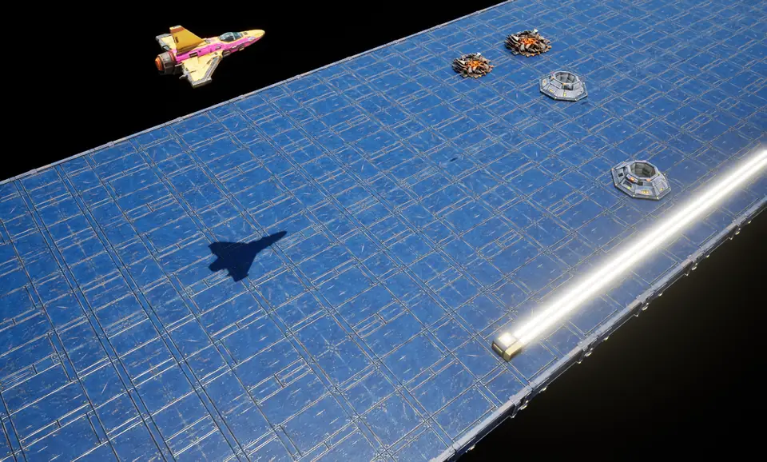
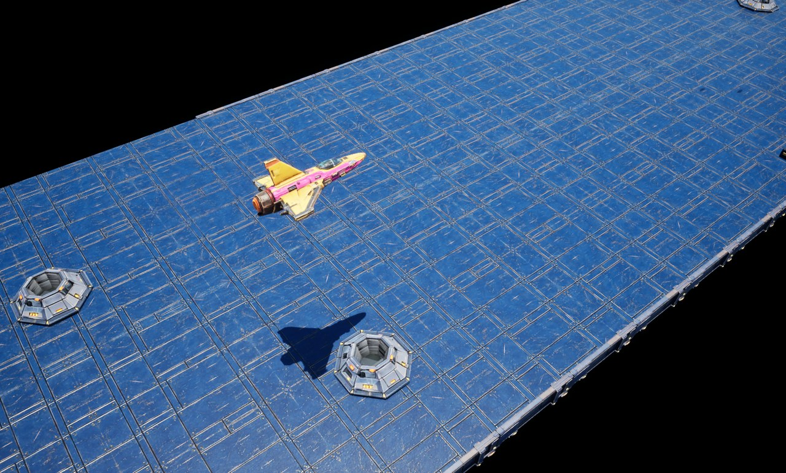
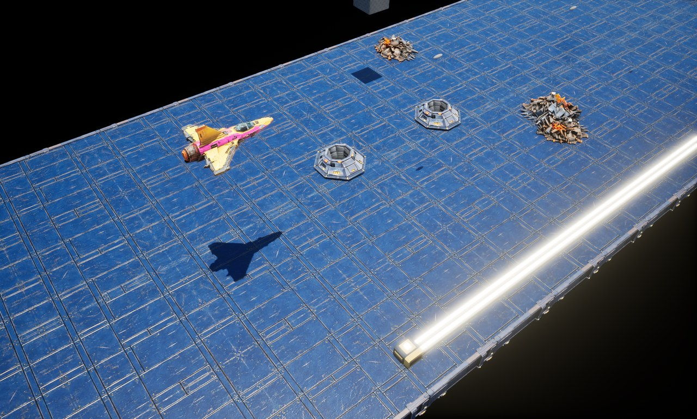
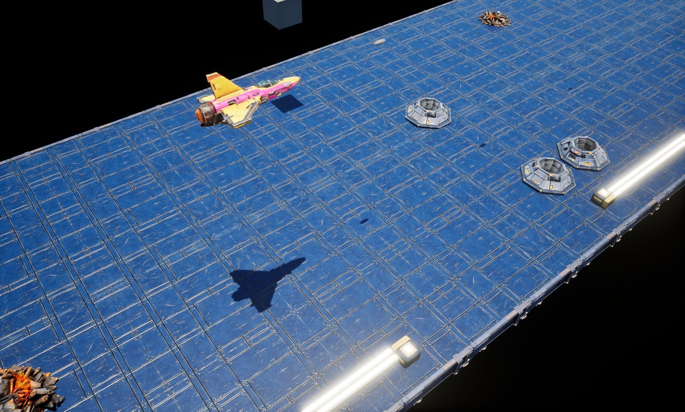
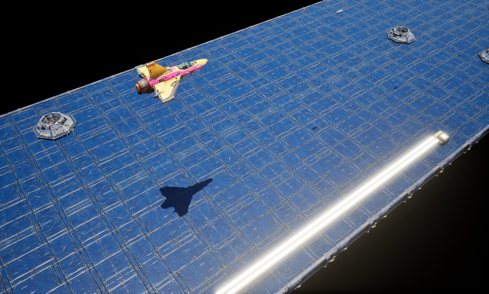
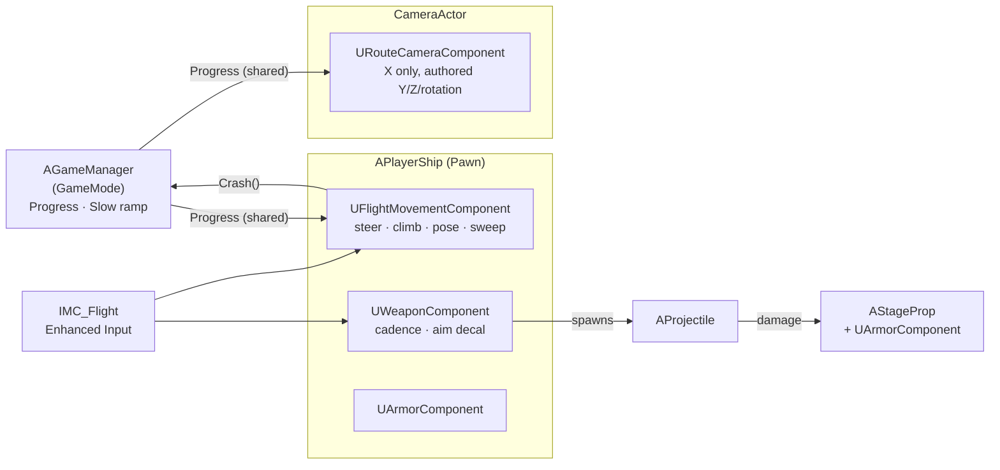

<div align="center">

# VYXXEN

**A 3D, Zaxxon-inspired isometric arcade shooter built in Unreal Engine 5.8 with C++.**




<sub>Live Play-In-Editor capture of <code>SampleLevel</code>: the ship weaves and climbs over the fortress while the camera scrolls with it.</sub>

</div>

<table>
  <tr>
    <td></td>
    <td></td>
  </tr>
  <tr>
    <td></td>
    <td></td>
  </tr>
</table>

## About

Vyxxen is a modern 3D take on the 1982 arcade classic *Zaxxon*. The ship flies forward on its own over a floating space fortress. The player steers, climbs, slows down and fires their way past silos, walls and targets, all seen through a fixed isometric camera.

It was built for the **Vertex School AI Game Development Bootcamp**. Gameplay is written in native C++ on Unreal's actor and component model, with Blueprints and assets used only for content and tuning.

## Highlights

- **One clock drives the scroll.** `AGameManager` keeps a single `Progress` value. The ship's movement component and the camera's route component both derive their X position from it rather than each adding up its own speed, so the camera can't drift away from the ship or scroll twice. In PIE testing the ship-to-camera offset held at exactly 184.62 cm for the entire run.
- **Arcade flight model.** Steering (Y) and climbing (Z) are independent and are not normalized together. The ship banks into turns and pitches into climbs, then eases back to level. Altitude is clamped to an editable min/max band.
- **Slowdown with a ramp.** Holding *Slow* eases forward and lateral speed down to 60% over an editable ramp time and back up on release, even if released mid-ramp. Climb speed is unaffected.
- **Sweep-based crashes.** Each movement step sweeps the hull capsule. It also checks for overlap after the pitch/bank pose is applied, so a wingtip clipping a wall counts as a crash. A crash stops the route and disables the weapon exactly once.
- **Reusable combat components.** `UWeaponComponent` fires at a steady rate regardless of frame rate by carrying leftover cooldown between frames. It also projects an aim-cursor decal onto whatever surface the next shot would hit. `UArmorComponent` turns Unreal damage into a single Alive → Destroyed transition. Both work on any actor.
- **Enhanced Input throughout.** Controls are semantic actions (`IA_Steer`, `IA_Climb`, `IA_Slow`, `IA_Fire`) in one mapping context, with no key names in gameplay code. Release, cancel and focus loss all clear their requests, so no input stays stuck on.
- **Static world.** The fortress scenery never moves. Only the ship and camera travel, which keeps level authoring simple and collisions stable.

## Controls

| Action | Keyboard | Gamepad |
|---|---|---|
| Steer left / right | `A` / `D` or `←` / `→` | Left stick X |
| Climb / dive | `W` / `S` or `↑` / `↓` | Left stick Y |
| Slow down (hold) | `Left Shift` | Left trigger |
| Fire (hold) | `Space` | Right trigger |

## Architecture



Both consumers tick after the GameManager (`AddTickPrerequisiteActor`), so the ship and camera always read the same `Progress` value within a frame.

| Class | Responsibility |
|---|---|
| [`AGameManager`](Source/Vyxxen/Public/GameManager.h) | Route clock: forward speed, slowdown ramp, `Progress`, route stop on crash |
| [`APlayerShip`](Source/Vyxxen/Public/PlayerShip.h) | Pawn that composes hull, mesh, muzzle, weapon, aim cursor and armor |
| [`UFlightMovementComponent`](Source/Vyxxen/Public/FlightMovementComponent.h) | Input → steer/climb, height clamp, pitch/bank easing, collision sweep |
| [`URouteCameraComponent`](Source/Vyxxen/Public/RouteCameraComponent.h) | Moves a placed camera along X with route progress and becomes the view target |
| [`UWeaponComponent`](Source/Vyxxen/Public/WeaponComponent.h) | Fire rate, projectile spawning, aim-cursor decal trace |
| [`AProjectile`](Source/Vyxxen/Public/Projectile.h) | World-space bolt that applies point damage once on hit |
| [`UArmorComponent`](Source/Vyxxen/Public/ArmorComponent.h) | Hit points, team, single destroyed transition and event |
| [`AStageProp`](Source/Vyxxen/Public/StageProp.h) | Placeable, shootable fortress object |

## Tuning

Every gameplay value can be edited in the Details panel of the ship Blueprint or the level's GameMode. There are no hidden data tables.

| Setting | Default | Where |
|---|---|---|
| Forward speed | 150 cm/s | `AGameManager` |
| Slow ramp time | 1 s | `AGameManager` |
| Lateral / climb speed | 200 / 200 cm/s | `UFlightMovementComponent` |
| Flight height band | 100 – 400 cm | `UFlightMovementComponent` |
| Max pitch / bank | 15° / 20° | `UFlightMovementComponent` |
| Fire interval | 0.15 s | `UWeaponComponent` |
| Projectile speed | 1800 cm/s | `UWeaponComponent` |

## Getting started

**Requirements:** Unreal Engine 5.8 and Visual Studio 2022 with the *Game development with C++* workload. The repo's [`.vsconfig`](.vsconfig) lists the exact components.

1. Clone the repository.
2. Right-click `Vyxxen.uproject` and choose **Generate Visual Studio project files**.
3. Open `Vyxxen.uproject` and let Unreal compile the `Vyxxen` module.
4. Open **`Content/Levels/SampleLevel`** and press **Play**.

`MainGame` is the short test strip used during development. `SampleLevel` is a full 90-metre, roughly one-minute route built from the same assets.

## Project structure

```
Vyxxen_UE/
├── Source/Vyxxen/          C++ gameplay module (Public/ headers, Private/ implementation)
├── Content/
│   ├── Levels/             MainGame (test strip) and SampleLevel (full route)
│   ├── Units/PlayerShip/   Ship mesh, textures and BP_vyxxen-ship
│   ├── Scenery/            Ground tiles, walls, silos, rubble, power lines
│   ├── Input/              Enhanced Input actions and IMC_Flight
│   └── Combat/             Aim-cursor decal material
├── Config/                 Engine, game, input and editor defaults
└── .planning/              Design plan: requirements, roadmap, research, phase plans
```

## Roadmap

- [x] Auto-scrolling flight with independent steer and climb
- [x] Pitch/bank pose, altitude limits and slowdown ramp
- [x] Route camera locked to the ship's forward progress
- [x] Weapon, projectiles, aim cursor, armor and shootable props
- [x] Full sample route built from the fortress art kit
- [ ] Fuel and refueling pods
- [ ] Enemy turrets, missiles and hazards
- [ ] Score, lives and HUD
- [ ] Stage progression and a boss encounter

The full design plan, including requirements, research and phase plans, is in [`.planning/`](.planning).

## Author

Built by **Angus** ([@tsuki9355](https://github.com/tsuki9355)) for the Vertex School AI Game Development Bootcamp.

Released under the [MIT License](LICENSE).
